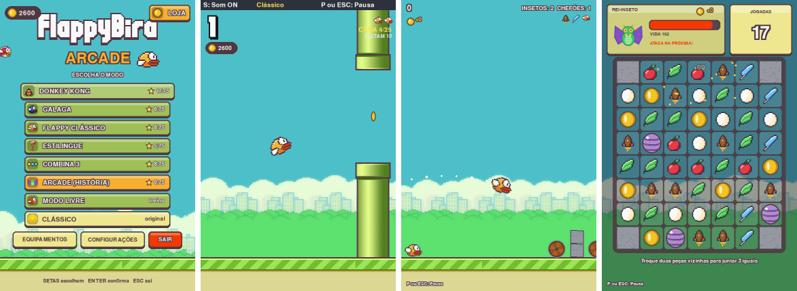
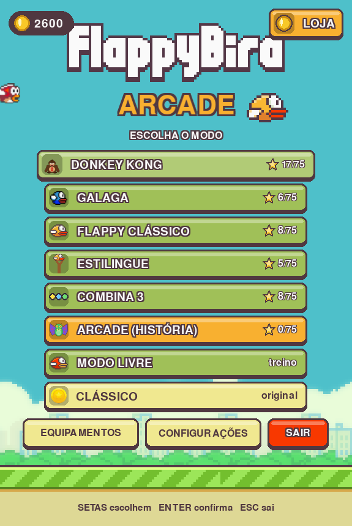
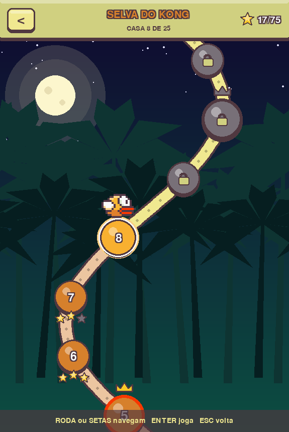
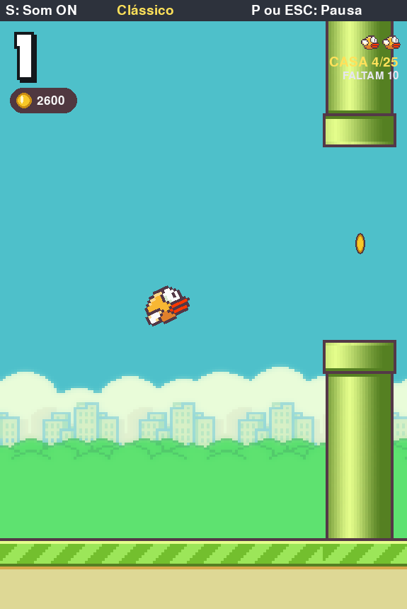
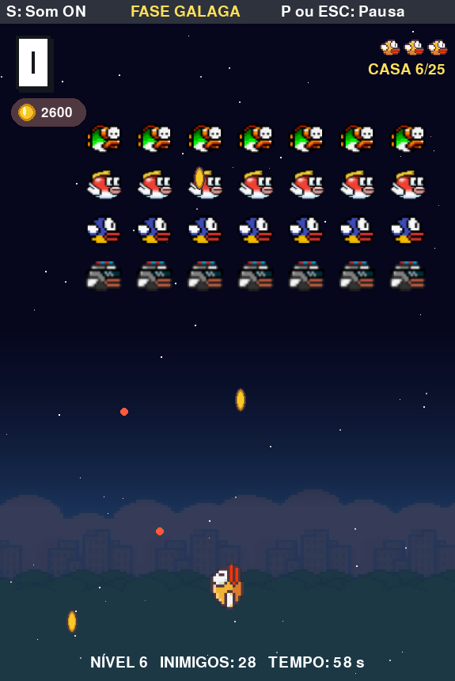
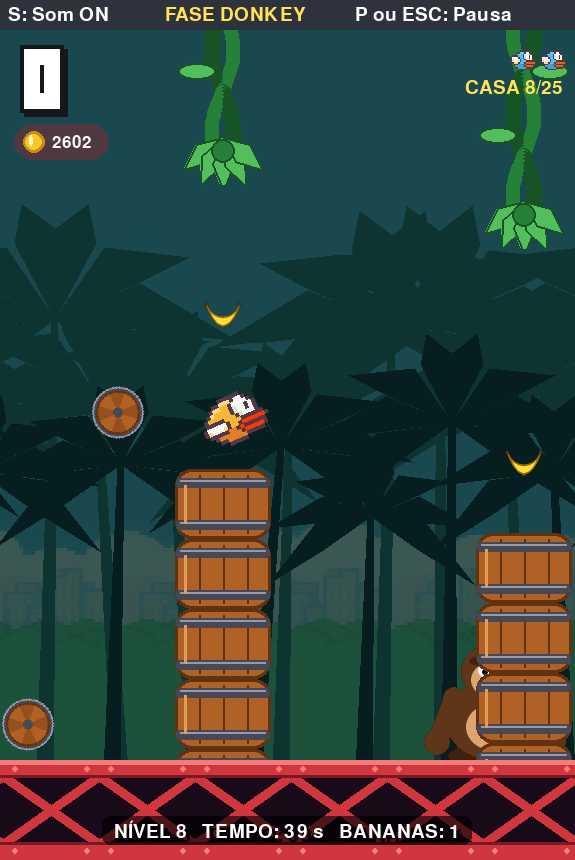
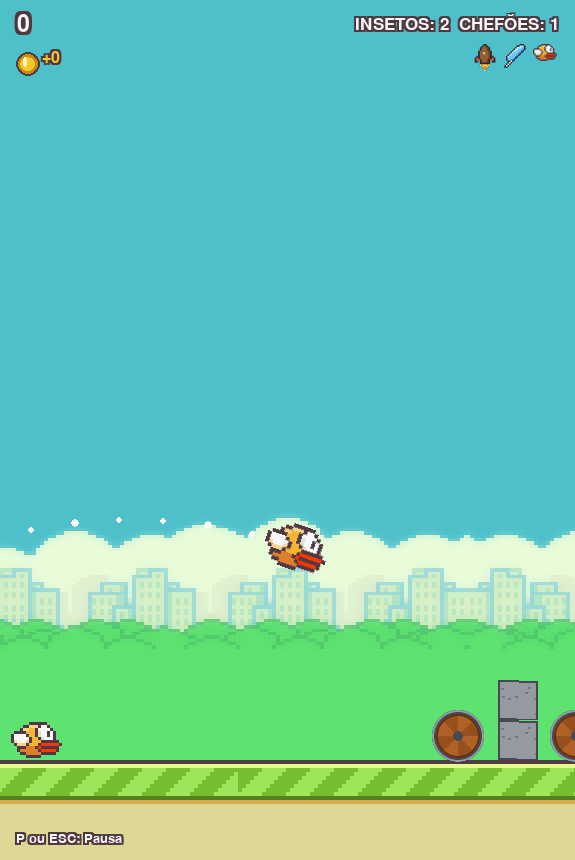
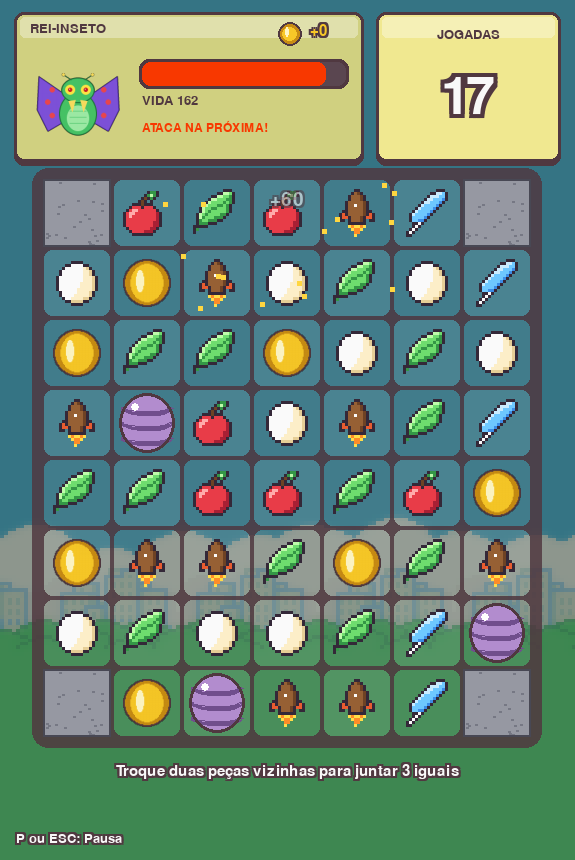
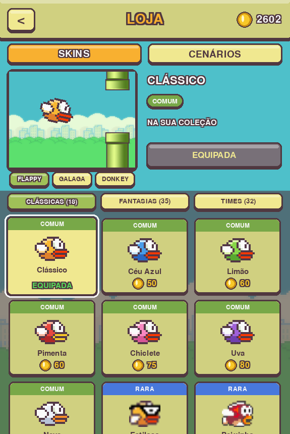

<div align="center">

# 🐤 Flappy Arcade

**Projeto 2 · Programação para Engenharia Mecânica (PPEM) · UFS/DMEC · 2026.2**

**Equipe:** Pedro · Ruan · Guilherme  ·  **Professor:** Wilson Luciano



*Flappy Bird, Galaga, Donkey Kong, estilingue e combinar 3 num só jogo, feito em Python e Pygame.*

</div>

## Sobre o jogo

O **Flappy Arcade** começou como o Flappy Bird das aulas da disciplina e cresceu em fases até virar um arcade completo. Ele tem cinco mapas de 25 casas, uma jornada em capítulos, um modo sem fim, loja com 86 skins (incluindo a lendária **Wilson Luciano**) e 31 cenários, e dois modos de jogo novos: um com física de verdade (Estilingue) e um quebra-cabeça de combinar peças (Combina 3).

O **modo Clássico** foi mantido **idêntico ao original**: um teste automático (*golden master*) compara cada partida com gravações do jogo original, quadro a quadro.

## Modos de jogo

| Modo | O que é |
|---|---|
| **Donkey Kong**, **Galaga**, **Flappy Clássico** | Mapas de 25 casas. Cada casa é um desafio com 3 vidas; chefões nas casas 5, 10, 15, 20 e 25; até 3 estrelas por casa. |
| **Estilingue** | Lance os pássaros para derrubar fortalezas de gelo, madeira e pedra (física 2D com *pymunk*). Pássaros especiais: Pena Dupla, Semente-Foguete e Ovo Nova. Barris explodem. |
| **Combina 3** | Troque peças vizinhas para juntar 3 iguais. Objetivos variados (pontos, coletar, gelo, caixas) e chefões que atacam o tabuleiro. Peças especiais: Pena-Raio, Ovo Nova e Arco-íris. |
| **Arcade (história)** | Jornada de 5 capítulos que mistura os estilos de fase. |
| **Modo Livre** | Sem game over: a dificuldade sobe com o tempo; recorde de sequência sem cair. |
| **Clássico** | O jogo original das aulas, com cadastro de nome, ranking e as fases Galaga e Donkey Kong. |

## Como jogar (Windows)

**Requisitos:** Python 3.12 e Git.

```powershell
git clone https://github.com/peu-as/FLAPPY_BIRD_ARCADE.git
cd FLAPPY_BIRD_ARCADE
python -m venv .venv
.venv\Scripts\Activate.ps1
pip install -r requirements.txt
python src/main.py
```

Atalhos de linha de comando: `python src/main.py --livre` (Modo Livre), `--classico` (Clássico) e `--casa combina3 5` (abre uma casa de qualquer mapa).

### Executável

Para gerar o `FlappyBird.exe`, que roda sem Python instalado, com o ícone da capa do jogo:

```powershell
pip install pyinstaller
python -m PyInstaller --noconfirm --clean --onefile --windowed --name FlappyBird --icon "assets/icone/flappy_arcade.ico" --add-data "assets;assets" src/main.py
```

O arquivo fica em `dist\FlappyBird.exe`. O ícone (`assets/icone/`) é gerado da capa por `python tools/gerar_icone.py`: o `.ico` tem 7 tamanhos (a capa nos grandes, só o pássaro nos pequenos) e a janela do jogo usa o mesmo desenho. Se o Explorer continuar mostrando o ícone antigo, é o cache do Windows: copie o `.exe` para outra pasta ou reinicie o Explorer. O progresso, as moedas e o ranking ficam em `%LOCALAPPDATA%\FlappyBird` e continuam lá depois de fechar o jogo.

## Controles

| Onde | Controles |
|---|---|
| Menus e mapas | Setas escolhem, ENTER confirma, ESC volta; mouse também funciona |
| Flappy (canos e pássaros) | ESPAÇO ou clique: bater asas |
| Fase Galaga | Setas ou A/D: mover · ESPAÇO ou clique: atirar |
| Fase Donkey Kong | ESPAÇO ou clique: bater asas · X: lançar o Banana-rang |
| Estilingue | Arraste o pássaro para trás e solte · no ar, clique ou ESPAÇO usa a habilidade · setas + ESPAÇO pelo teclado · roda do mouse ou A/D olham a fortaleza |
| Combina 3 | Clique em duas peças vizinhas ou arraste · setas movem o cursor, ESPAÇO segura a peça |
| Durante a partida | P ou ESC: pausa (com configurações, recomeçar e sair) · S: liga/desliga o som no Clássico |
| Menu principal | **Ctrl + Shift + A**: Modo Apresentação (libera tudo para demonstração sem tocar no save; o mesmo atalho volta ao jogo normal) |

## Galeria

<table>
  <tr>
    <td align="center"><br>Menu principal</td>
    <td align="center"><br>Mapa de 25 casas</td>
    <td align="center"><br>Flappy</td>
    <td align="center"><br>Fase Galaga</td>
  </tr>
  <tr>
    <td align="center"><br>Fase Donkey Kong</td>
    <td align="center"><br>Estilingue</td>
    <td align="center"><br>Combina 3 (chefão)</td>
    <td align="center"><br>Loja</td>
  </tr>
</table>

## O que o jogo tem

- **Progressão:** estrelas por casa, casas que abrem em sequência, chefões, dificuldade em 25 níveis medida por robôs de teste.
- **Economia:** moedas nas fases, bônus por estrela, loja com 86 skins (clássicas, fantasias, times e a lendária, com poses animadas e efeitos dourados) e 31 cenários; Equipamentos para escolher cenário fixo ou uma playlist aleatória.
- **Save seguro:** arquivo versionado, gravação atômica com backup; saves antigos são migrados e saves corrompidos não derrubam o jogo.
- **Som:** músicas e efeitos 8 bits compostos por código (`tools/gerar_musica.py` e `tools/gerar_sons.py`).
- **Acessibilidade e conforto:** pausa automática ao perder o foco, efeitos visuais e sons desligáveis, janela redimensionável, dicas de tutorial na primeira vez de cada mecânica.

## Estrutura do projeto

```
src/main.py                  ponto de entrada (também o do executável)
src/flappy_arcade/
  core/       loop, janela, pilha de cenas, relógio, caminhos
  config/     dados de jogo: física, dificuldade, mapas, economia, catálogos, casas dos modos novos
  systems/    save, carteira, loja, progresso, áudio, Modo Apresentação
  gameplay/   regras e desenho das fases (Flappy, Galaga, Donkey, Estilingue, Combina 3)
  scenes/     telas: menu, mapas, casa, loja, pausa, configurações
  ui/         tema de cores, botões e textos
tests/        663 testes automáticos (pytest), incluindo o golden master do Clássico
tools/        verificação antes do commit, robôs de calibração, geradores de som e música, importadores de artes e do personagem, gerador do ícone
assets/       imagens, sons, skins, personagem lendário, cenários e ícone usados pelo jogo
artes/        folhas originais das artes (não vão para o executável)
docs/         documentação técnica
aulas/        material da disciplina
```

Detalhes da arquitetura (regras de dependência, cenas, save, cada modo) em [`docs/arquitetura.md`](docs/arquitetura.md).

## Testes

```powershell
python -m pytest                  # 663 testes automáticos
python tools/verificar_jogo.py    # abre todas as telas sem janela + testes; deve terminar com PRONTO PARA O COMMIT
```

- **Golden master:** o Clássico é comparado com gravações do jogo original (física, pontuação e sorteios iguais).
- **Robôs de calibração:** `tools/playtest.py`, `tools/playtest_estilingue.py` e `tools/playtest_combina3.py` jogam as casas para medir a dificuldade (resultados em [`docs/balanceamento.md`](docs/balanceamento.md)).
- **Testes manuais:** roteiro em [`docs/testes_manuais.md`](docs/testes_manuais.md).

## Entrega do trabalho

```powershell
python tools/montar_entrega.py --relatorio <PDF do relatório> --apresentacao <arquivo .pptx>
```

Monta `entrega/PPEM Python – Pedro-Ruan-Guilherme – Projeto 2 – 26.2/` com o código (só o que está commitado), o relatório, a apresentação e o link do GitHub, todos com os nomes no padrão da disciplina, e confere se cada arquivo abre. `--exe` inclui o `dist\FlappyBird.exe`.

## Documentação

| Documento | Conteúdo |
|---|---|
| [`docs/arquitetura.md`](docs/arquitetura.md) | Organização do código, cenas, save, cada modo de jogo |
| [`docs/balanceamento.md`](docs/balanceamento.md) | Dificuldade e economia, com as medições dos robôs |
| [`docs/como_adicionar_artes.md`](docs/como_adicionar_artes.md) | Passo a passo para importar novas skins e cenários |
| [`docs/testes_manuais.md`](docs/testes_manuais.md) | Roteiro de testes manuais e de entrega |
| [`docs/roteiro_apresentacao.md`](docs/roteiro_apresentacao.md) | Roteiro da apresentação: falas, demonstração e perguntas prováveis |
| [`CREDITOS.md`](CREDITOS.md) | Créditos, recursos de terceiros e bibliografia |
| [`aulas/`](aulas/) e [`docs/sprints/`](docs/sprints/) | Material da disciplina |

## Histórico de desenvolvimento

O projeto seguiu as sprints da disciplina (00 a 05: ambiente, física, obstáculos e colisões, recursos, testes e entrega) e depois cresceu em fases, registradas em commits e tags no Git (`git log --oneline` e `git tag` mostram o histórico):

| Fases | Incremento |
|---|---|
| Base | Versão fusão: Flappy Bird + fases Galaga e Donkey Kong |
| 1 – 7 | Código dividido em módulos, Modo Livre, mapas de 25 casas, jornada Arcade, moedas e skins, pausa e configurações, primeira rodada de testes e balanceamento |
| 8 – 9 | Importação das artes novas (skins e cenários); catálogos e save versão 2 |
| 10 – 11 | Cenários nas fases; Galaga e Donkey Kong com os cenários e as skins |
| 12 – 13 | Loja com abas e Equipamentos; bônus redesenhados |
| 14 | Economia, decisões de dificuldade e verificação de qualidade |
| 15 | Modo Estilingue (física com pymunk) |
| 16 – 17 | Modo Combina 3: tabuleiro, peças especiais, 25 casas com objetivos e chefões |
| 18 | Economia dos modos novos, sons, dicas de tutorial e verificação por um revisor independente |
| 19 | README, créditos, licença e roteiro de testes para a entrega |
| 20 | Relatório técnico |
| 21 | Apresentação, roteiro e montagem da pasta de entrega (`tools/montar_entrega.py`) |
| 22 | Skin lendária Wilson Luciano (poses animadas, aura, rastro e faíscas douradas) e ícone do executável feito da capa |

## Créditos e licença

O **código** é distribuído sob a **licença MIT** (veja [`LICENSE`](LICENSE)): parte dele vem do projeto didático do Prof. Wilson Luciano ([wilson-luciano/flappybird](https://github.com/wilson-luciano/flappybird)), também MIT, e o restante foi escrito pelo grupo.

A licença do código **não se aplica aos recursos de terceiros** (imagens e sons do repositório do curso, personagens e marcas que inspiraram skins e modos). As artes novas de skins e cenários, a folha do personagem lendário e a capa foram geradas com o ChatGPT (OpenAI). Este é um projeto acadêmico, sem fins comerciais. Créditos completos e bibliografia em [`CREDITOS.md`](CREDITOS.md).
